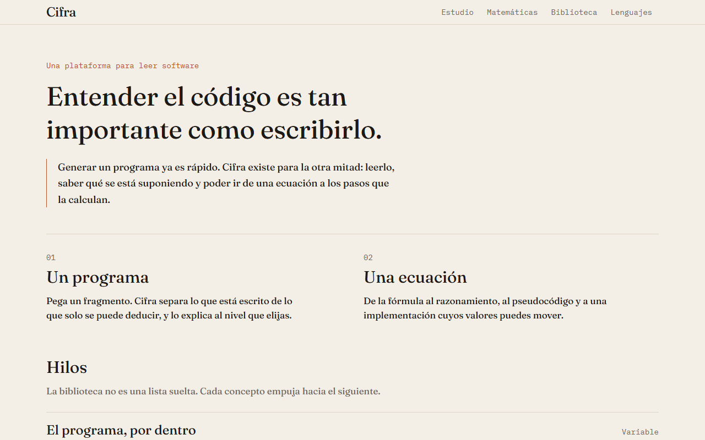

# Cifra

Plataforma web para **entender programas**, no solo para generarlos. Generar código ya es rápido;
Cifra se ocupa de la otra mitad: leerlo, saber qué se está suponiendo en cada línea y poder ir de
una fórmula matemática al código que la calcula.



## Qué hay

- **Estudio** — pegas un fragmento y eliges el nivel (empezando, práctica, profundidad). Un analizador
  local lee el texto sin IA y separa lo que está escrito de lo que solo se puede deducir. Si lo pides,
  un modelo con voz pedagógica explica el programa a partir de esas observaciones, siempre distinguiendo
  lo comprobado de lo inferido. Se puede marcar una línea o un tramo y preguntar solo por ahí.
- **Sistema de skills** — el comportamiento del modelo no sale de una orden genérica. Ocho skills
  (pedagogía, análisis, matemáticas, algoritmos, depuración, optimización, lenguajes y seguridad
  defensiva) se componen según el código y la pregunta. Algunas van siempre; el resto se quitan o
  añaden a mano, y cada una muestra por qué está activa.
- **Matemáticas** — puentes de una fórmula a su significado, al razonamiento, al pseudocódigo y a
  implementaciones reales con valores experimentables. No es una colección de definiciones.
- **Biblioteca** — conceptos organizados en hilos conectados (de variables a memoria y propiedad en
  Rust, de recursión a pila y complejidad), no una lista suelta.
- **Lenguajes** — el mismo problema resuelto en varios lenguajes, con las diferencias que de verdad
  cambian la forma de escribir, y ensayos sobre las particularidades de cada uno.

## Principios

- La plataforma no ejecuta el código del usuario y lo dice por escrito; no simula lo que no hace.
- Cada llamada al modelo es explícita y limitada: cuota real, caché y respuestas con forma comprobada.
- El progreso de lectura se guarda solo en este navegador. No hay cuentas sin necesidad.
- El código fuente sigue los mismos principios que enseña: simple, legible, con decisiones explicadas.

## Stack

TypeScript · React 19 · TanStack Start/Router · Tailwind v4 · Vite · modelo vía `XAI_API_KEY`
solo en el servidor.

## Desarrollo

```bash
npm install
npm run dev        # servidor de desarrollo en el puerto 8080
npm run typecheck  # tipos
npm run test       # pruebas unitarias
npm run build      # build de producción
```

## Hoja de ruta

El proyecto se construye por versiones. Qué debe alcanzar cada una está escrito, con criterios,
en [`NOVEDADES.md`](NOVEDADES.md).
